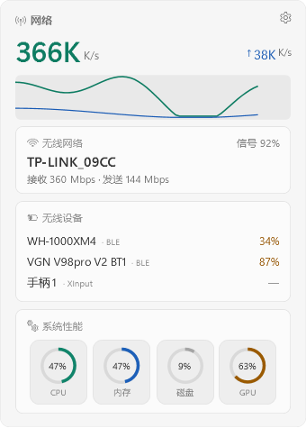
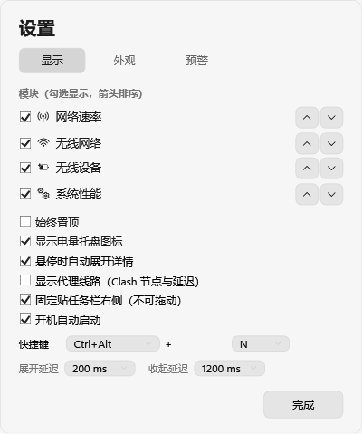

# TrayLens

一个 Win11 风格的托盘监控小工具：托盘里用 16×16 的数字图标显示网速和电量，点开是右下角的 Fluent 面板，看网络、无线设备、性能。



## 功能

**托盘图标**
- 实时网速（下行）；可选第二个图标显示无线设备电量
- 图标是程序自己画的，跟着明暗主题走

**面板**
- 网速曲线 + 当前 Wi-Fi 名称、信号、收发速率
- 无线设备：只列当前连着的（BLE 电量 / 经典蓝牙 / XInput 手柄），标注来源
- 系统性能：CPU / 内存 / 磁盘 / GPU 四个圆环，点一下原地展开详情
  - CPU、GPU 详情叠温度曲线
  - 内存详情右侧列 Top3 进程，磁盘详情右侧列分区
- 代理线路（可选）：Clash Verge 的节点名与延迟

**外观**
- 亚克力 / 纯色 / 自定义图片三种背景，不透明度可调
- 跟随系统明暗主题，10px 圆角，DWM 阴影



**预警**
- CPU / 内存 / GPU（占用率与温度）/ 设备电量
- 阈值、持续时长、提示文案都可改
- 提醒是自绘浮窗，不依赖系统通知（Win11 的托盘气泡经常被静默丢弃）

**其他**
- 开机自启（写当前用户注册表，不需要管理员）
- 全局热键开关面板，默认 `Ctrl+Alt+N`，可改
- 面板失焦自动收起

## 运行要求

- Windows 10 1809+ 或 Windows 11
- [.NET 8 Desktop Runtime](https://dotnet.microsoft.com/download/dotnet/8.0)
- 不需要管理员权限

## 使用

1. 到 [Releases](../../releases) 下载最新的 zip，解压到任意目录
2. 双击 `TrayLens.exe`
3. 托盘图标右键可以进设置、退出

面板默认固定在右下角，按 `Ctrl+Alt+N` 或点托盘图标开关。

## 已知限制

- **经典蓝牙耳机、2.4G 接收器读不到电量**——Windows 只对 BLE 暴露 Battery Service，这类设备只能显示名字，电量标「—」
- **通知区域只能放 16×16 图标**，所以面板是独立浮窗，不属于任务栏
- **CPU 温度读不到**：需要加载内核驱动、要管理员权限，本项目默认只启用 GPU 温度
- Clash 状态目前只支持 Clash Verge（走它的命名管道 API），其他客户端会退回网卡/注册表判断

## 从源码构建

需要 .NET 8 SDK：

```bash
dotnet build TrayLens.csproj -c Release
dotnet run --project TrayLens.csproj
```

打包成单文件：

```bash
dotnet publish TrayLens.csproj -c Release -r win-x64 --self-contained false \
  -p:PublishSingleFile=true -p:IncludeNativeLibrariesForSelfExtract=true -o publish
```

产物是 `publish\TrayLens.exe`（约 28MB，依赖 .NET 8 桌面运行时）。想不依赖运行时就加 `--self-contained true`，体积约 150MB。

### 自检参数

程序带了一组离线自检开关，方便改 UI 时不用手点：

```
--test            输出一次采集结果（网速/代理/GPU/温度/设备）
--preview         渲染托盘图标
--glyphs          渲染字形码表
--flyout-shot     渲染面板截图（亮/暗/展开）
--settings-shot   渲染设置页截图
--compare         图标风格对比
--make-icon       重新生成 app.ico
```

## 许可

MIT
